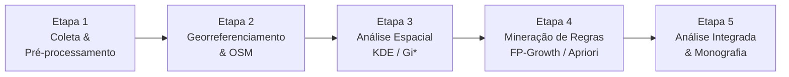

# Plano do TCC: Mineração de Dados e Análise Espacial de Acidentes de Trânsito em João Monlevade (MG)

> **Título completo:** Mineração de Dados e Análise Espacial de Acidentes de Trânsito em João Monlevade (MG): Identificação de Hotspots e Descoberta de Padrões

**Dados disponíveis:**
- [`2025.csv`](C:\Users\Windows Lite BR\Documents\n8n\tcc\TCC1\2025.csv) — microdados REDS/Sejusp-MG (João Monlevade)
- [`mapa_acidentes_joao_monlevade.html`](C:\Users\Windows Lite BR\Documents\n8n\tcc\TCC1\mapa_acidentes_joao_monlevade.html) — mapa interativo já gerado
- [`data_set.ipynb`](C:\Users\Windows Lite BR\Documents\n8n\tcc\TCC1\data_set.ipynb) — notebook de análise exploratória

---

## 1. Objetivos

### 1.1 Objetivo Geral

Analisar os padrões espaciais e relacionais dos acidentes de trânsito no município de João Monlevade (MG) por meio de técnicas de mineração de regras de associação e estatística espacial, visando a identificação de pontos críticos (hotspots) e a caracterização dos fatores determinantes associados à severidade e ocorrência dos acidentes.

### 1.2 Objetivos Específicos

| # | Objetivo | Técnicas / Ferramentas |
|---|----------|----------------------|
| 1 | **Coleta e Tratamento** — filtrar e higienizar os dados REDS, delimitando recorte temporal e perímetro de João Monlevade | Pandas, OpenRefine |
| 2 | **Mapeamento e Geocodificação** — georreferenciar registros e efetuar snapping sobre a malha viária OSM | OSMnx, Shapely, Geocoding API |
| 3 | **Identificação de Hotspots** — mapear e ranquear pontos críticos via KDE e Getis-Ord Gi* | PySAL, KDE (scipy / ESDA) |
| 4 | **Mineração de Padrões Relacionais** — extrair regras de associação multivariadas (Apriori e FP-Growth) | mlxtend, pyfpgrowth |
| 5 | **Síntese e Diagnóstico** — integrar resultados espaciais e associativos em diagnóstico prescritivo | Folium, Matplotlib |

---

## 2. Metodologia — Pipeline KDD em 5 Etapas



---

### Etapa 1 — Coleta, Limpeza e Engenharia de Atributos

**Fonte:** microdados de ocorrências de trânsito do sistema REDS/Sejusp-MG (Acidente de Trânsito).

**Atividades:**
1. **Filtragem espacial** — isolamento estrito dos registros de João Monlevade (MG).
2. **Tratamento de dados** — remoção de duplicatas; imputação ou eliminação de registros com missings severos; padronização textual de logradouros, bairros e categorias.
3. **Engenharia de atributos:**
   - Discretização de hora em faixas: `Madrugada (00–05h)`, `Manhã (06–11h)`, `Tarde (12–17h)`, `Pico Noturno (18–23h)`.
   - Categorização de condição climática (Seco, Chuva, Neblina…).
   - Categorização de tipo de pista (Simples, Dupla, Múltipla, Especial).
   - Severidade das vítimas (Sem Vítima, Com Ferido, Com Morto).

---

### Etapa 2 — Georreferenciamento e Extração da Malha Viária

1. **Geocodificação** — conversão de endereços estruturados (logradouro + número + cruzamento + bairro) em coordenadas geográficas (lat/lon) via API de geocoding.
2. **Extração da malha viária** — download dos vetores viários de João Monlevade via `OSMnx`.
3. **Snapping** — associação dos pontos de acidente aos segmentos OSM mais próximos, corrigindo imprecisões de GPS e garantindo topologia consistente.

---

### Etapa 3 — Análise Espacial de Hotspots

#### 3.1 Estimativa de Densidade de Kernel (KDE)
- Raio de busca fixo e/ou adaptativo.
- Superfície contínua de calor para visualização primária de adensamentos.
- Exportação em raster e sobreposição no mapa Folium.

#### 3.2 Getis-Ord Gi*
- Cálculo do indicador de autocorrelação espacial local.
- Identificação de **hotspots** (clusters de altos valores) e **coldspots** (clusters de baixos valores).
- Níveis de confiança: 90 %, 95 % e 99 %.
- Resultados ranqueados por avenida / segmento viário.

---

### Etapa 4 — Mineração de Regras de Associação

#### 4.1 Construção das Transações
Cada linha = 1 acidente; cada coluna = atributo categórico discretizado.

Exemplo de item set:
```
{Severidade=Grave, Pista=Molhada, Horario=PicoNoturno, Tipo=Atropelamento, Via=Avenida}
```

#### 4.2 Algoritmos
| Algoritmo | Biblioteca | Observação |
|-----------|-----------|------------|
| **FP-Growth** | `pyfpgrowth` / `mlxtend` | Principal — mais eficiente para bases densas |
| **Apriori** | `mlxtend` | Comparativo e validação cruzada |

#### 4.3 Métricas de Avaliação
| Métrica | Significado | Limiar inicial |
|---------|------------|---------------|
| **Suporte** | Frequência do padrão na base | ≥ 0,05 |
| **Confiança** | Precisão da regra X → Y | ≥ 0,60 |
| **Lift** | Grau de interdependência / ganho de informação | > 1,0 (positivo) |

---

### Etapa 5 — Análise Integrada, Escrita e Apresentação

1. **Cruzamento de resultados** — sobreposição dos mapas de hotspots às regras de associação extraídas, para identificar a causa-raiz específica de cada zona crítica.
2. **Documentação** — redação do relatório técnico, monografia e artigo científico.
3. **Material gráfico** — mapas temáticos, gráficos de regras e apresentação para a banca examinadora.

---

## 3. Resultados e Produtos Esperados

| # | Produto | Descrição |
|---|---------|-----------|
| 1 | **Base Estruturada e Georreferenciada** | Arquivo tratado, enriquecido com coordenadas e atributos discretizados, pronto para reuso |
| 2 | **Atlas Cartográfico de Hotspots** | Mapas temáticos de João Monlevade com densidade KDE e clusters Gi* |
| 3 | **Catálogo de Regras de Associação** | Repositório de regras validadas por Lift, evidenciando combinações de fatores de risco |
| 4 | **Relatório Técnico e Recomendações** | Diretrizes operacionais para órgãos de trânsito e forças de segurança municipais |
| 5 | **Monografia e Artigo Científico** | TCC formatado conforme normas acadêmicas + artigo para periódico ou congresso (Transportes / Computação Aplicada) |

---

## 4. Estrutura da Monografia (esboço)

1. Introdução e contextualização
2. Revisão bibliográfica: KDD, mineração de regras, análise espacial de acidentes, KDE, Getis-Ord Gi*
3. Metodologia: pipeline KDD em 5 etapas
4. Resultados — Etapa 1: estatísticas descritivas e perfil dos dados
5. Resultados — Etapa 2: mapa georreferenciado e malha viária OSM
6. Resultados — Etapa 3: mapas KDE e hotspots Gi*
7. Resultados — Etapa 4: regras de associação e análise de Lift
8. Resultados — Etapa 5: diagnóstico integrado por zona crítica
9. Discussão: limitações, comparação com literatura, implicações práticas
10. Conclusão, limitações e trabalhos futuros

---

## 5. Restrições e Decisões Abertas

- **Geocodificação:** API a definir (Google Maps, Nominatim/OSM, HERE). Avaliar cobertura para João Monlevade antes de escolher.
- **Malha viária:** OSMnx como fonte primária; validar completude das avenidas urbanas.
- **N mínimo para regras:** revisar limiares de suporte/confiança após exploração da base final.
- **Artigo-alvo:** confirmar congresso/periódico (sugestão: ANPET, SBRH ou SBBD).

---

## 6. Entregáveis no Projeto `TCC1`

Quando executar cada etapa (após aprovação do plano):

- `data_set.ipynb` — notebook unificado com todas as etapas
- `outputs/hotspots_kde.html` — mapa KDE interativo
- `outputs/hotspots_gi_star.html` — mapa Gi* interativo
- `outputs/regras_associacao.csv` — catálogo de regras extraídas
- `outputs/relatorio_tecnico.md` — relatório com recomendações
- `docs/monografia.pdf` — versão final da monografia

> Sem commit até aprovação explícita.
